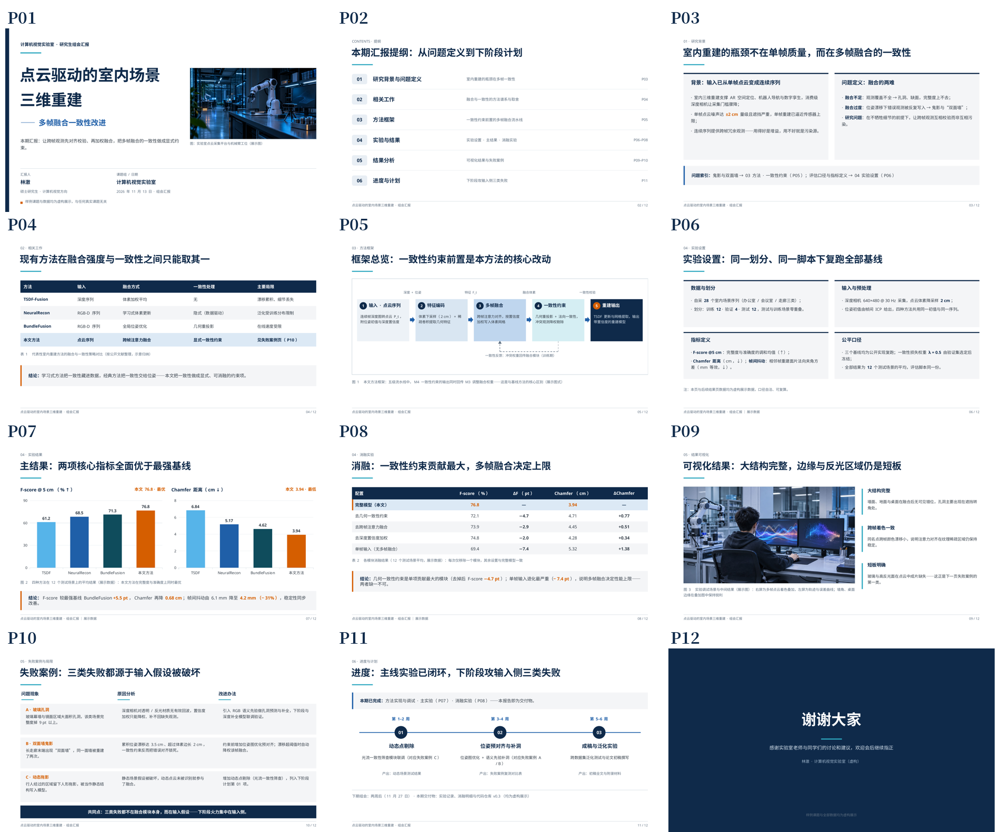
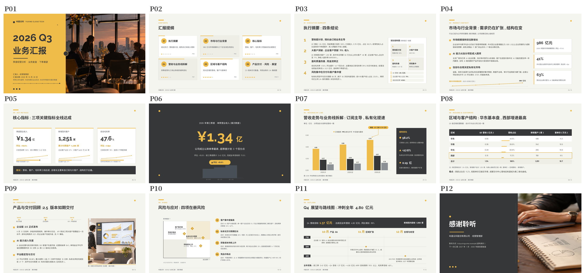
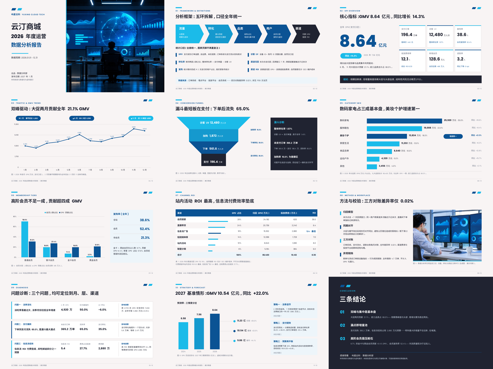
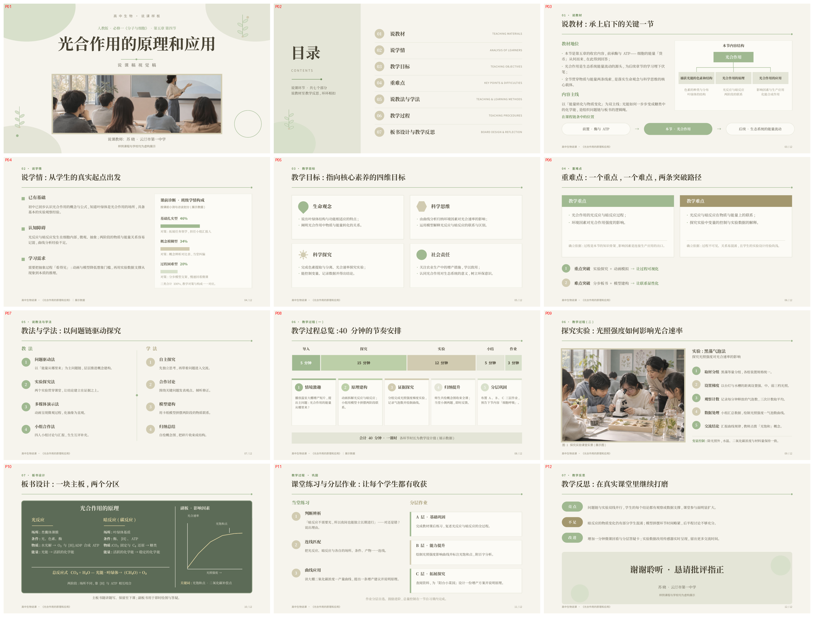
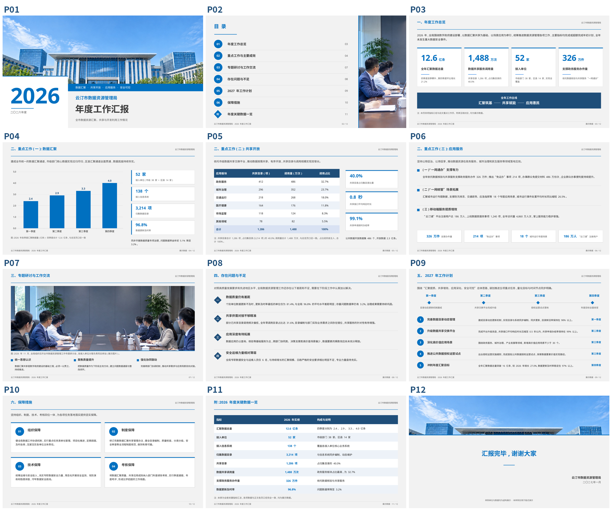
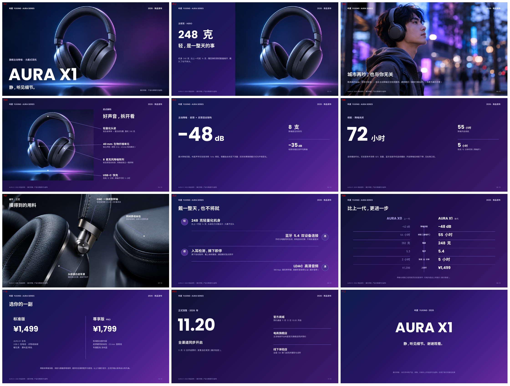

# SlideDNA · PPT 审美 Skill:参照拆解式演示文稿设计系统

> 通用模板 skill 出来的 PPT 为什么总是"很一般"?因为它喂的是平均审美。
> 这套 skill 反过来:**先定场景 → 选 2~4 套该场景的顶级参照 → 把设计参数逐项量出来 → 按数值规范原创构建 → 逐页渲染验收。**
> 审美是参照绑定的:喂什么档次,出什么档次。

## 它是什么

一套装进 AI Agent(Claude Code 等支持 skill 的工具)的**演示文稿设计规范系统**。它不是模板文件包——里面没有一张现成版式让你套字;它给你的 AI 立了一套规矩,让它做 PPT 时不再凭"平均审美"自由发挥:

**先定场景 → 按场景选风格包(配色、字阶、页型全部写死成数值) → 按你的学科/行业加载变量扩展 → 原创构建每一页 → 逐页渲染验收 → 交付原生可编辑的 .pptx。**

规范里的每一个数值——确切的 hex 色值、pt 字号梯度、间距与构图比例——都从 2~4 套该场景的顶级参照模板逐形状实测提炼。写不出数值,模型就会自由发挥回平均脸;数值写死了,档次就稳了。

## 效果展示

以下 6 套样板均为照本 skill 规范从零原创构建的虚构课题成品(各 12 页,完整 .pptx 在 `ppt-aesthetic-skill/examples/`,数据为展示数据并已在页上标注):

**学术 · 点云驱动的室内场景三维重建组会汇报**

**商务 · SaaS 公司季度经营汇报(稳重系)**

**数据 · 电商年度运营数据分析报告**

**教学 · 高中生物《光合作用》说课**

**正式 · 市数据资源管理局年度工作汇报(政务蓝)**

**产品 · 旗舰降噪耳机新品发布(渐变满版)**

## 它能做什么

**1. 按场景定配色与调性——每个场景一套写死的色彩纪律,不靠临场感觉配色:**
- 学术:白底深蓝顶会风,冷静克制,只给数据和结论留颜色
- 商务:稳重系(炭灰 + 芥末黄)/ 活力系(五色序列)/ 路演系(深蓝紫墨 + 亮青单强调)三选一
- 数据:深蓝正式 / 紫单色咨询 / 白底六色序 / 科技蓝,四套互斥色方案按报告类型选
- 教学:莫兰迪低饱和 / 粉彩手绘两分支,≤3 个点缀色,装饰从封面到内容页逐页递减
- 正式:党政红 / 政务蓝两分支,全册统一字体,庄重感靠层级与缎带,不靠堆符号
- 产品:渐变满版 / 白底产品 / 轻奢米白三条路线,展示字特大与正文极小的强反差

**2. 按大类适配内容——共 33 个大类有专属配方:** 你的学科、行业、单位类型对上号,就有为这一类写死的招牌页构图、指标词库和口径红线(数学的公式推导链、金融风控的迁徙矩阵口径、国企的称谓落款惯例……),不用从通用页型硬凑。完整清单见下方覆盖表。

**3. 全套页型照配方组装:** 封面、目录、章节页、图文页、数据页、对比页、时间轴、组织结构、结尾页,都有明确的构图配方与组件语法(圆徽章、数据条、对比脊、图注制等),整册风格统一。

**4. 数据呈现有规矩:** 图表一律原生可编辑(不是贴图),一页一图、标签直贴数据点、该标注的峰值与口径注都写死;表格用细线原生表格;3D 图表、歪曲数据的画法在禁忌清单里明令禁止。

**5. 交付前有验收协议:** 逐页渲染目检(不只看封面)、几何重叠扫描清零、教学/模板类的指导语放进演讲者备注不进版面、虚构或示例数字必须就地标注——避免"看着还行、一打开全是事故"。

**6. 商用安全:** 成品逐形状原创构建,参照模板的文件、图片、版式从不进入成品;每套成品交付前做媒体哈希零重合核查与品牌词扫描。字体、徽标等红线写在 SKILL.md 的 Commercial use guardrails 一节。

## 风格包一览

| 风格包 | 场景 | 构成 |
|---|---|---|
| academic | 学术组会 / 答辩 | 深蓝顶会风,结论式标题 + 眉题 + 图注制 |
| business | 商务汇报 / 路演 | 稳重系 / 活力系 / 路演系 三选一 |
| data | 数据分析报告 | 四套互斥数据色方案,一页一图、标签直贴 |
| education | 教学课件 | 莫兰迪 / 粉彩手绘 两分支 |
| formal | 正式汇报 | 党政红 / 政务蓝 两分支 |
| product | 产品发布 | 渐变满版 / 白底产品 / 轻奢米白 三条路线 |

## 覆盖的大类(变量扩展)

风格包是场景层,变量扩展是大类层。你的学科、行业、单位类型在下面有名字,就有为你这类写的专属配方:

| 风格包 | 变量扩展 | 覆盖大类 |
|---|---|---|
| education 教学 | 学科扩展 | 语文、数学、英语、物理、化学、生物、历史、地理、思想政治(9 科) |
| academic 学术 | 学科扩展 | 理工科实验型、医学/生命科学统计型、文科文本/史料型、经管实证型(4 类) |
| business 商务 | 行业扩展 | 软件/SaaS、制造业、零售电商、金融服务、医疗健康、工程/地产(6 行业) |
| data 数据 | 分析对象扩展 | 电商运营、金融风控、用户增长/留存、财务经营分析、人力资源分析、供应链/物流(6 类) |
| product 产品 | 品类扩展 | 智能硬件、软件/App、消费品、汽车与出行服务(4 品类) |
| formal 正式 | 单位类型扩展 | 政府机关、国有企业、事业单位(含高校/医院)、群团与行业协会(4 类) |

用法:选风格包时把大类一起告诉 agent(例:「用教学包,高中数学,函数的单调性说课」),agent 会自动加载对应变量节。大类不在表内也能用风格包构建,变量目录欢迎按既有体例补写、随用随长。

## 快速开始

1. 把 `ppt-aesthetic-skill/` 整个目录放进你的 agent 的 skills 目录
2. 对 agent 说:「用学术风格包,按这份内容做一套组会 PPT」;有明确大类时带上大类:「用教学包,高中数学说课」
3. agent 会按风格包的数值规范(有大类时叠加变量扩展配方)构建原生可编辑的 .pptx,并执行验收协议后交付

示例产出:`ppt-aesthetic-skill/examples/` 内有 6 套完整样板(见上方效果展示):
`academic_sample.pptx`、`business_sample.pptx`、`data_sample.pptx`、`education_sample.pptx`、`formal_sample.pptx`、`product_sample.pptx`

## 方法要点(为什么有效)

- **参照只用 2~4 套**:1 套定主调,其余交叉验证;取多套共识,弃单套怪癖。堆 20 套只会把流派平均稀释
- **规范必须数值化**:确切 hex、pt 梯度、间距与构图比例、强调色出现位置纪律——写不出数值,模型就会自由发挥回平均脸
- **参照 ≠ 复制**:提取的是设计参数与规律,成品逐形状原创构建;参照原文件、其图片与版式从不进入成品(每套成品都做媒体哈希零重合核查)。这也使产出可安全商用,详见 SKILL.md 的 Commercial use guardrails 一节
- **验收抓几何问题**:审美事故大多是遮挡、溢出、丢表这类几何问题,靠逐页渲染 + 重叠扫描抓,不靠感觉

## 参照来源说明

风格包参数实测自一批免费可下载的模板,仅作设计研究;本仓库**不包含**任何第三方模板文件、图片或字体。

## 许可

见仓库 LICENSE 文件。本项目采用自定义许可:**免费使用、修改,用它做出的 PPT 可自由商用;但禁止出售、转售本 Skill 本身(原样、改名、打包进付费产品均不可),免费分享请保留出处与许可文本。**
